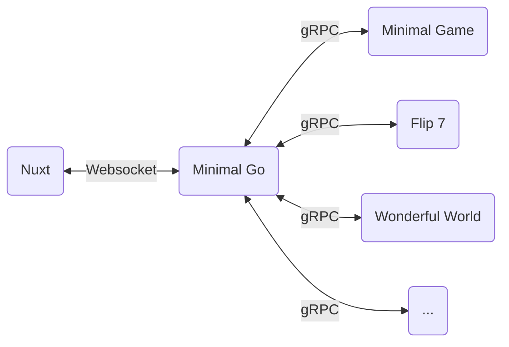
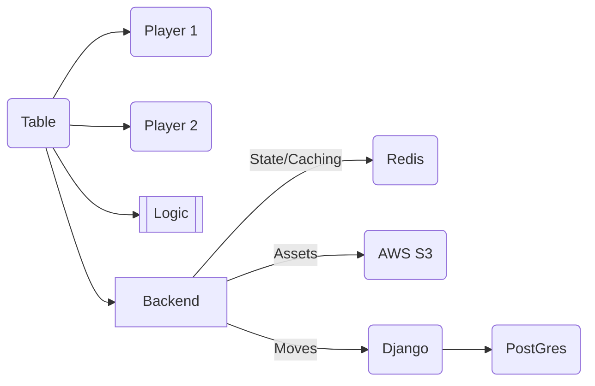

# Minimal Game Service

The minimal game micro-service is a gRPC server that implements the full logic for a particular given board game. The main server ((services/minimalgo)[services/minimalgo]) can send and recieve instructions for a particular given game and implement the logic of the game the Nuxt frontend.

## Overview

This architecture allows the games to be modular and completely independent from the main server entrypoint whose role is to manage tables and clients.



## Creating a game

1. Fork the project and create a branch name with the name of the game
2. Duplicate the [Minimal game](./services/minimalgame) folder and rename it. This folder contains all the logic to run the game autonomously as a gRPC server.
3. Code the logic of your game in the [base file ](./services/minimalgame/internal/logic/base.go)where you can implement complex moves based on the instructions provided in `models.Instruction`
4. Once the game is completed, you must [integrate the protocole buffer files.](README.md)
5. You can deploy your own game on an AWS EC2, GPC or Azure instance ensuring that the game has a valid url that the main entrypoint server can address

**Structure of the minimal game folder**

```

├── internal
│   ├── backend
│   ├── logic
│   └── models
└── tests
```

**Structure of the logic folder**

```

.
├── base.go <-- Game logic goes here
├── errors.go
├── registry.go
└── table.go
```

The [main entrypoint server](services/minimalgo) implements all the main functions used to run a board game efficiently. If you game implements very unique actions, call the  gRPC function `ExecuteInstruction` which accepts any custom action that has not been implemented in the standard library.

### Tables

A table  a single modular space used to run a unique given game with a set of players.

> [!IMPORTANT]
> It's important to understand that each game (or minimalgame package) functions like a unique small service with its own logic and state.
> It interracts and works with backend services like AWS S3/Redis which can be your own hosted services but also Django which the single source of truth for moves.



## gRPC services

This section is going to address the role and functions of each gRpc service function [listed in the minimalgame.proto file.](proto/minimalgame/v1/minimalgame.proto)

```ProtoBuf

service TableService {
    rpc CreateTable (CreateTableRequest) returns (TableResponse);
    rpc GetTable (GetTableRequest) returns (TableResponse);
    rpc JoinTable (JoinTableRequest) returns (TableResponse);
    rpc LeaveTable (LeaveTableRequest) returns (TableResponse);
    rpc StartGame (StartGameRequest) returns (TableResponse);
    rpc EndGame (EndGameRequest) returns (TableResponse);
    rpc DistributeCards (DistributeCardsRequest) returns (TableResponse);
    rpc NextRound (NextRoundRequest) returns (TableResponse);
    rpc NextTurn (NextTurnRequest) returns (TableResponse);
    rpc ShuffleCards (ShuffleCardsRequest) returns (TableResponse);
    rpc BanPlayer (BanPlayerRequest) returns (TableResponse);
    rpc ExchangeCardsWithPlayer (ExchangeCardsWithPlayerRequest) returns (TableResponse);
    rpc ExchangeCardsWithDeck (ExchangeCardsWithDeckRequest) returns (TableResponse);
    rpc ExecuteInstruction (ExecuteInstructionRequest) returns (TableResponse);
    rpc Reset (ResetRequest) returns (TableResponse);
    rpc Ping (PingRequest) returns (TableResponse);
}
```

### Create Table

This sevice is called in order to create a new table. A table is a defined as unique space where players participate to unique given game. Each table carries the specific logic of the game being played.

### Get Table

Returns the current state of a table

### Join Table

Allows players *except* for the one who has created the table to join a game that has not yet started. Any players who join afterwards becomes automatically an observer.

### Leave Table

Allows a player who is currently on a table to leave the game

### Start Game

Starts the game (manually or automatically)

### End Game

Ends the game (manually or automatically)

### Distribute Cards

Distribute cards to the players. This is a manual trigger.

### Next Round

Goes to the next round

### Next Turn

Increases the `CurrentPlayerIndex` by one. It can be reversed (decreased)

### Shuffle Cards

Shuffles the cards in the given array

### Ban Player

Bans a player from the particular given game

### Exchange Cards With Player

Allows two players to exhange cards

### Exchange Cards With Deck

Allows one or multiple players to exchange cards with the deck. Exchanged cards must be placed below the deck.

### Execute Instruction

Executes an instruction that is not listed in the above.

### Reset

Resets the current table

### Ping

Endpoint used to check if the table is still running

## Commands

```Shell

# Generate cryptographic key for authentication

ssh-keygen -t ed25519 -C "email@example.com"
```
