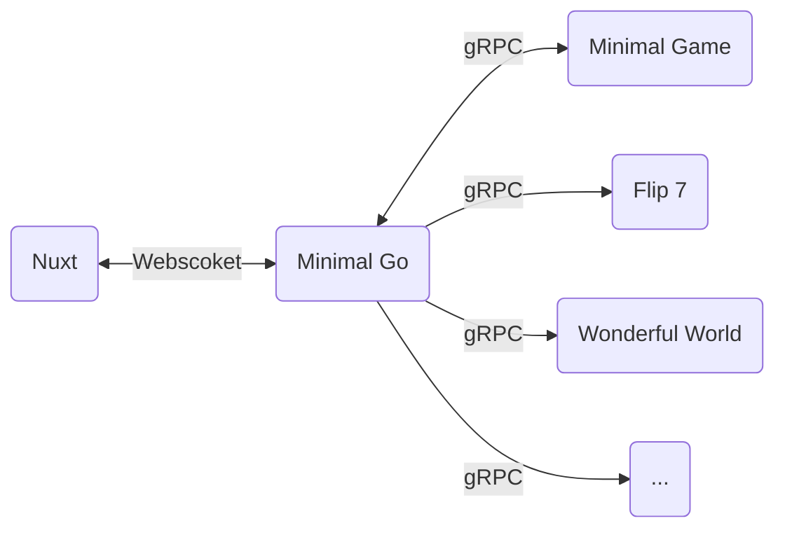

# Minimal Game Service

The minimal game micro-service is a gRPC server that implements the full logic for a particular given board game. The main server ((services/minimalgo)[services/minimalgo]) can send and recieve instructions for a particular given game and implement the logic of the game the Nuxt frontend.

## Overview

This architecture allows the games to be modular and completely independent from the main server entrypoint whose role is to manage tables and clients.



## Commands

```Shell

# 1. Install plugins

go install google.golang.org/protobuf/cmd/protoc-gen-go@latest

go install google.golang.org/grpc/cmd/protoc-gen-go-grpc@latest

# 2. Add directory to path

export PATH="$PATH:$(go env GOPATH)/bin"

# 3. Verify

which protoc-gen-go

which protoc-gen-go-grpc
```

```Shell

protoc --go_out=./minimalgameproto --go_opt=paths=source_relative --go-grpc_out=./minimalgameproto --go-grpc_opt=paths=source_relative minimalgameproto.proto
```
