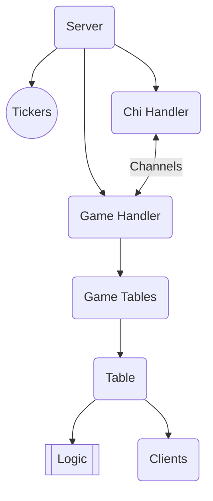

# Minimal Go Server

The minimal Go appcliation is the root application used to create a game for myboardgames. It handles server, game logic, and HTTP routes.

## Architecture

The architecture is simple, modular and is composed of three main parts: [server](services/minimalgo/internal/server/app.go), [game logic](services/minimalgo/internal/logic), and [HTTP handling](services/minimalgo/internal/http/app.go).

The server is the main entry point and manages connections and routing. It spins two goroutines : one for handling connections and one for game logic.

Both of these gorountines communicate through a channel in `server` to coordinate game state. This keeps the logic decoupled and easier to manage.

### Logic

The logic itself of the game that is being implemented should be located under the [the logic folder](services/minimalgo/logic).
